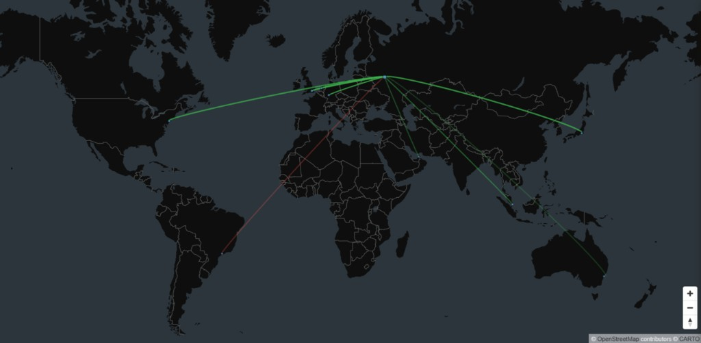

# ГеоАтлас

ГеоАтлас — визуализатор трафика МСЭ: принимает syslog, парсит логи вендоров, кладёт события в ClickHouse и рисует связи на 2D/3D карте. Польза — быстрее понять географию и характер потоков: репутация IP, аномалии (сканы, beaconing, lateral) и разбор алерта живут рядом с картой, а не в отдельных инструментах.

- **Парсеры МСЭ.** UserGate, FortiGate, Cisco ASA, Cisco FTD (Firepower) и универсальный фолбэк (Generic KV); несетевые строки осознанно пропускаются, а не засоряют `parse_errors`.
- **Карта и глобус.** Связи на 2D-карте и 3D-глобусе; группировка узлов по IP, `/24`, городу (по умолчанию) или стране.
- **Аномалии рядом с картой.** Сканирование портов и обход подсети, резкий рост блокировок и трафика, beaconing, обход внутренней сети, новая страна, контакт с отмеченным адресом; разбор алерта и охоты без отдельного SIEM.
- **Репутация IP.** Offline-списки и URL-фиды: фильтр и подсветка дуг на карте.
- **Один пакет.** `geoatlas-X.Y.Z.tar.gz` для Ubuntu 20.04+ и Oracle Linux 8+ / RHEL; syslog `:514`, ClickHouse, React SPA на одном хосте (IPv4-only, доставка at-most-once).

**Актуальный релиз:** [v2.7.2](https://github.com/varlahin-gena/geoatlas/releases/tag/v2.7.2) (`VERSION` = 2.7.2). Лимиты appliance — [архитектура](docs/architecture.md).



Дуги из точки МСЭ по миру: **зелёные** — разрешено (`allowed`), **красные** — заблокировано (`blocked`).

## Содержание

- [Быстрый старт](#быстрый-старт)
- [Возможности](#возможности)
- [Документация](#документация)
- [Лицензия](#лицензия)
- [Безопасность](#безопасность)
- [Структура репозитория](#структура-репозитория)

## Быстрый старт

Нужны Linux-сервер (Ubuntu 20.04+ или Oracle Linux 8+ / RHEL-совместимый), Docker поставит установщик, порты **80** (UI) и **514** tcp/udp (syslog).

```bash
VER=2.7.2

cd /tmp
curl -fLO "https://github.com/varlahin-gena/geoatlas/releases/download/v${VER}/geoatlas-${VER}.tar.gz"
curl -fLO "https://github.com/varlahin-gena/geoatlas/releases/download/v${VER}/geoatlas-${VER}.tar.gz.sha256"
sha256sum -c "geoatlas-${VER}.tar.gz.sha256"
tar -xzf "geoatlas-${VER}.tar.gz"
cd "geoatlas-${VER}"
```

**Ubuntu:**

```bash
sudo ./deploy/ubuntu/install_ubuntu.sh
```

**Oracle Linux / RHEL / Rocky / Alma:**

```bash
sudo ./deploy/oracle_linux/install_oraclelinux.sh
```

Установщик спросит модули, HTTPS и пароль admin (мин. 10 символов, буква и цифра). После запуска:

1. Откройте `http://<IP_сервера>/` (при HTTPS — `https://…`).
2. Войдите как **admin** (роль `administrator`).
3. Направьте syslog МСЭ на `:514` — [syslog.md](docs/syslog.md); загрузите GeoIP — [geoip.md](docs/geoip.md).

Подробности, удаление и обновление — [docs/install.md](docs/install.md).

## Возможности

- **Приём логов** — syslog TCP/UDP `:514` и доп. порты коннекторов (UI **Система → Коннекторы**)
- **Авторизация** — учётка `admin` по умолчанию; роли `administrator` / `operator` / `dashboard`
- **HTTPS** — опционально на nginx со своими PEM (редирект HTTP→HTTPS)
- **GeoIP** — загрузка и правка базы из UI
- **ClickHouse** — хранение, настраиваемый TTL, резервное копирование
- **Расследование** — охоты (`/hunts`), разбор алерта (`/investigate`), конструктор поиска и шаблоны запросов на карте
- **Операции** — тест парсеров, журнал ошибок парсинга, страница системного мониторинга, логи контейнеров (`/dozzle/`)
- **Edge hardening** — proxy gate, rate limit API, re-auth, ротация токенов, HSTS при HTTPS

## Документация

| Раздел | Описание |
|--------|----------|
| [Архитектура](docs/architecture.md) | Сервисы, поток данных, product limits, Ingest SLO, TTL |
| [Установка](docs/install.md) | Требования, пакет, Ubuntu / Oracle Linux, удаление |
| [Syslog](docs/syslog.md) | Подключение МСЭ / SIEM |
| [Конфигурация](docs/configuration.md) | `.env`, секреты, модули |
| [Обслуживание](docs/operations.md) | Запуск, профили, retention, бэкапы, логи, обновление |
| [GeoIP](docs/geoip.md) | CSV, загрузка с сервера, 502/OOM |
| [UI и HTTP API](docs/ui.md) | Страницы SPA, роли, OpenAPI **1.21.0** |
| [Репутация](docs/reputation.md) | Фиды и offline-списки |
| [Аномалии](docs/anomalies.md) | Типы (`port_scan`, `byte_surge`, `beaconing`, `lateral_fanout`, …), ack/assign, разбор |
| [Разработка](docs/development.md) | Локальный стек из git |
| [CONTRIBUTING.md](CONTRIBUTING.md) | PR, DCO, coding standards, тесты |
| [CODE_OF_CONDUCT.md](CODE_OF_CONDUCT.md) | Кодекс поведения |
| [GOVERNANCE.md](GOVERNANCE.md) | Роли, решения, access continuity |
| [Roadmap](docs/roadmap.md) | Намерения на 12 месяцев |
| [Требования безопасности](docs/security-requirements.md) | Чего ждать / не ждать от продукта |
| [Assurance case](docs/assurance-case.md) | Threat model и аргумент защищённости |
| [Структура репо](docs/repo-layout.md) | Дерево каталогов |
| [RELEASING.md](RELEASING.md) | Версии продукта / OpenAPI / схемы CH |
| [SECURITY.md](SECURITY.md) | Сообщение об уязвимостях |
| [CHANGELOG.md](CHANGELOG.md) | История релизов |
| [OpenSSF Passing](docs/openssf-best-practices.md) | Шпаргалка Passing |
| [OpenSSF Silver](docs/openssf-silver.md) | Шпаргалка Silver |

Контракт REST: [`openapi.yaml`](openapi.yaml) (документ OpenAPI **1.21.0**).

## Лицензия

ГеоАтлас распространяется под [Apache License 2.0](LICENSE). Продукт бесплатный и общедоступный; релизы публикуются на GitHub.

Баги, вопросы и заказ доработок — через [Issues](https://github.com/varlahin-gena/geoatlas/issues). Как прислать патч — [CONTRIBUTING.md](CONTRIBUTING.md).

## Безопасность

Уязвимости — только приватно, см. [SECURITY.md](SECURITY.md) (подтверждение в течение 5 рабочих дней). Обычные баги — в Issues.

Краткий checklist для прод-установки:

- Секреты только через `./start.sh` (`API_AUTH_TOKEN`, `SESSION_SECRET`, `INGEST_SHARED_SECRET`, `CLICKHOUSE_PASSWORD`)
- Пароли УЗ: минимум 10 символов, буква и цифра, не из common-list
- Одноразовый пароль admin: `.admin_password_once` (600), не stdout
- UI за HTTPS при доступе из сети; не публиковать ClickHouse `8123`/`9000`, backend `8080`/`1514`
- `GA_REQUIRE_PROXY=1` в compose (не открывать backend мимо nginx); rate limit API — `GA_API_RATE_LIMIT_*`
- ClickHouse `default`: networks loopback+RFC1918 (не `::/0`)
- Syslog `:514` **без TLS/auth** — ограничьте источником МСЭ (`GA_SYSLOG_ALLOW_FROM` / Security Group / firewall)
- Ingest внутри docker: маркер с `INGEST_SHARED_SECRET` + `INGEST_ALLOW_FROM=syslog-ng` (`POST /api/ingest` — Bearer/ops, без маркера)
- Reputation URL-фиды: только публичные IPv4-хосты (private/metadata блокируются)
- Ротация env Bearer: `API_AUTH_PREVIOUS_TOKEN` / `API_OPS_PREVIOUS_TOKEN`; именованные токены — rotate в UI
- Установка и обновление: только `geoatlas-X.Y.Z.tar.gz` с GitHub Releases; проверяйте `.sha256` до `./update.sh` (опционально online: `.cosign.bundle` + `cosign verify-blob`, см. [install.md](docs/install.md))

## Структура репозитория

| Путь | Назначение |
|------|------------|
| `backend/` | Go API, парсеры, GeoIP, ingest |
| `frontend/` | React SPA → nginx |
| `clickhouse/` | конфиг и скрипты CH |
| `deploy/` | установщики Ubuntu / Oracle Linux |
| `docs/` | документация оператора и разработчика |
| `docs/images/` | скрины для README |
| `scripts/` | CI, pack-release, бэкапы |
| `openapi.yaml` | контракт HTTP API (OpenAPI **1.21.0**) |

Полное дерево: [docs/repo-layout.md](docs/repo-layout.md).
